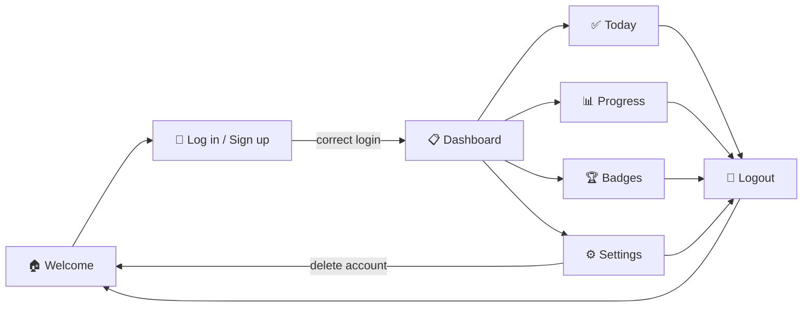
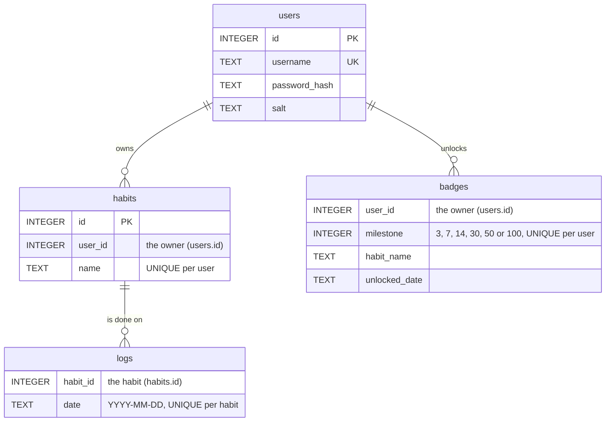

<div align="center">

# 🔥 Consistify

### Build habits that stick.

A Python desktop habit tracker with streaks, a GitHub-style heatmap, badges and secure user accounts.


<br>


**[Features](#-features) · [Screenshots](#-screenshots) · [Getting Started](#-getting-started) · [How It Works](#-how-it-works) · [Security](#-security) · [Team](#-team)**

<br>


</div>

<br>

## ✨ Features

### 🏠 Landing & accounts
- Animated landing page: phrases orbit the title, a typewriter cycles example habits and preview cards float.
- Navbar with smooth scrolling to each section.
- "Why habits matter" section with numbers that count up when you scroll to it.
- Split-screen Log in / Sign up page with a 👁 show-password toggle.
- Every user has their own private habits, history and badges.

### ✅ Daily tracking
- **Today** page with a greeting, today's date and 4 stat cards: *Done today*, *Best streak*, *This week* and *Badges*.
- Add a habit in one click. Duplicates are refused with a warning.
- Round checkboxes, a 🔥 streak pill on every habit and a hover-only 🗑 delete (with "are you sure?").
- An animated **Today's progress** bar.
- 🎉 **Confetti** when every habit is done for the day, or when a new badge unlocks.
- Side panel: a mini 30-day heatmap, your next badge and a quote of the day.

### 📊 Progress & insights
- Summary tiles: total check-ins, active days, average per day and longest streak.
- **90-day heatmap**, GitHub-style. Today is outlined. Click any day to see which habits you did.
- **Habit share** donut: check-ins per habit over the last 30 days. Hover a slice for its numbers.
- **This week** bar chart with a dashed average line.
- **Consistency** ring: % of the last 30 days with at least one habit done.
- Stats table: current streak, best streak and last-30-days % for every habit. The top habit gets a 👑.

### 🏆 Badges & milestones
- 6 badges for streaks of **3 🌱, 7 🔥, 14 ⚡, 30 🏅, 50 💎 and 100 👑** days.
- Unlocked badges show which habit earned them and the date.
- Locked badges show a progress bar, and a **Next up** card shows how many days are left.
- Click an unlocked badge to replay its celebration.

### ⚙️ Settings & security
- Account card: username, number of habits and badges unlocked.
- Change password (your current password is required).
- Danger zone: delete your account and all its data (password + confirmation required).

### 📤 Export
- **Export CSV** saves a report wherever you choose: habit, current streak, best streak, completion % (30 days) and total days done.

<br>

## 📸 Screenshots

<table>
  <tr>
    <td width="50%"></td>
    <td width="50%"></td>
  </tr>
  <tr>
    <td align="center"><b>Landing page</b>: orbiting phrases, typewriter and floating cards</td>
    <td align="center"><b>Log in / Sign up</b>: split-screen with an animated heatmap</td>
  </tr>
  <tr>
    <td width="50%"></td>
    <td width="50%"></td>
  </tr>
  <tr>
    <td align="center"><b>Today</b>: tick habits, watch streaks and progress grow</td>
    <td align="center"><b>Progress</b>: heatmap, donut, weekly chart and stats</td>
  </tr>
  <tr>
    <td width="50%"></td>
    <td width="50%"></td>
  </tr>
  <tr>
    <td align="center"><b>Badges</b>: six streak milestones to unlock</td>
    <td align="center"><b>Settings</b>: change password or delete your account</td>
  </tr>
</table>

<br>

## 🚀 Getting Started

### Requirements
- **Python 3.10+**. That's it.
- Nothing to `pip install`: Consistify only uses Python's standard library.

### Run it

```bash
git clone https://github.com/KrishivSharma45/Consistify.git
cd Consistify
```

| Windows | macOS |
| --- | --- |
| `py main.py` | `python3 main.py` |

The database file `habits.db` is created automatically the first time you run the app.

> [!TIP]
> **Try the demo**
> Want a full account with 90 days of history, streaks and badges?
> Run `py seed_demo.py` (Windows) or `python3 seed_demo.py` (macOS), then log in with **demo / demo123**.
> Running it again resets the demo account to the same fresh data.

> [!NOTE]
> **macOS:** if you get `No module named tkinter` or the window opens blank, install Python from [python.org](https://www.python.org/downloads/). It comes with a working Tkinter.

<br>

## 🧠 How It Works

### App flow



### Database

Four tables in one local SQLite file (`habits.db`):



- One row in `logs` = one habit done on one day. The `UNIQUE` rule means a day can't be counted twice.
- Deleting a habit also deletes its logs. Deleting an account deletes everything that belongs to it.

### 🔥 Streak logic

1. Start from **today**.
2. If today isn't ticked yet, start from **yesterday** instead, so your streak doesn't "break" in the morning before you've had a chance.
3. Count back one day at a time until a day is missing.

<details>
<summary><b>Example</b></summary>

<br>

| Mon | Tue | Wed | Thu | Fri (today) |
| :-: | :-: | :-: | :-: | :-: |
| ❌ | ✅ | ✅ | ✅ | not yet |

Today isn't done, so counting starts at Thursday: Thu ✅, Wed ✅, Tue ✅, Mon ❌ → **streak = 3**.
Tick Friday and it becomes **4**.

The **best streak** is the longest run of back-to-back days ever logged for a habit.
A **badge** unlocks the first time any habit's current streak reaches its milestone, and it stays unlocked after that.

</details>

### 🟧 Heatmap colors

Each square is one day. Its color depends on **how many habits were done that day**:

| Habits done | 0 | 1 | 2 | 3 | 4+ |
| --- | :-: | :-: | :-: | :-: | :-: |
| Shade | empty | darkest orange | → | → | brightest orange |

The five shades live in `theme.HEATMAP`, so changing the theme recolors every heatmap in the app.

<br>

## 🔐 Security

Your passwords are never stored. Only a salted hash is saved, and all data stays on your own device.

| Protection | What the code does | Why it matters |
| --- | --- | --- |
| 🧂 **Salted password hashing** | **PBKDF2-HMAC-SHA256** with **100,000 iterations** and a unique random 16-byte salt per user (`os.urandom`) | Even if someone copies `habits.db`, they can't read the passwords, and two users with the same password get different hashes |
| ⏱️ **Constant-time comparison** | `hmac.compare_digest` checks the hash | The check takes the same time whether the first character or the last one is wrong, so timing can't leak the hash |
| 💉 **SQL Injection protection** | Every query uses `?` placeholders (parameterized queries) | What a user types is always treated as data, never as SQL code |
| 🕵️ **One error message for login** | A wrong username and a wrong password both show *"Incorrect username or password"* | The login form doesn't tell an attacker which usernames exist |
| 🔑 **Re-authentication for password change** | Your current password is required | Someone at an unlocked computer can't silently take over the account |
| 🗑️ **Protected account deletion** | Password + an "are you sure?" confirmation | Deleting everything can't happen by accident or by someone else |

<details>
<summary><b>What do these terms mean?</b></summary>

<br>

- **PBKDF2-HMAC-SHA256** = *Password-Based Key Derivation Function 2*, using *Hash-based Message Authentication Code* with *Secure Hash Algorithm 256-bit*. It runs the hash 100,000 times on purpose, so each password guess is slow for an attacker.
- **Salt**: random bytes mixed into the password before hashing. Precomputed "rainbow tables" become useless.
- **SQL** = *Structured Query Language*, the language used to talk to the database. **SQL Injection** is an attack where typed text is run as SQL code.
- **Constant-time comparison**: a comparison that doesn't stop early at the first difference.

</details>

<details>
<summary><b>Known limits (honest notes)</b></summary>

<br>

- Sign-up says *"Username already taken"*, so a username's existence can be checked there. That's the normal trade-off for a friendly sign-up form.
- Login skips the hashing step when a username doesn't exist, so the response time could in theory hint at which usernames exist.
- `habits.db` itself isn't encrypted. Habit names and dates can be read by anyone with access to the file (passwords can't).

</details>

<br>

## 📁 Project Structure

```text
Consistify/
├── main.py          # Starts the app: one window, page switching, sidebar and tabs
├── welcome.py       # Animated landing page with navbar, "Why habits matter" and features
├── auth.py          # Split-screen Log in / Sign up page
├── gui.py           # Today page: habit list, checkboxes, progress bar, side panel, CSV export
├── heatmap.py       # Progress page: heatmap, donut, weekly chart, consistency ring, stats table
├── badges.py        # Badges page: trophy shelf, "Next up" card and the six milestone cards
├── settings.py      # Settings page: account info, change password, delete account
├── database.py      # All SQLite code: tables, accounts, password hashing, habits, streaks, badges, CSV
├── ui.py            # Shared widgets: cards, rounded buttons, rings, pills, scroll pages, confetti
├── theme.py         # Every color and the font in one place (black & orange theme)
├── seed_demo.py     # Fills the database with a demo account (demo / demo123)
├── screenshots/     # Images used in this README
├── .gitignore       # Keeps habits.db, the CSV report and caches out of Git
└── README.md
```

> Every page file can also be run on its own (for example `py heatmap.py`) to open a test window. `gui.py`, `heatmap.py`, `badges.py` and `settings.py` log in as the demo user.

<br>

## 🛠️ Tech Stack

**Standard library only: zero third-party packages.**

| Tool | Used for |
| --- | --- |
| 🐍 **Python 3** | The whole app |
| 🖼️ **Tkinter** (`tkinter`, `ttk`, `messagebox`, `filedialog`) | Windows, canvases, charts, animations, dialogs |
| 🗄️ **SQLite** (`sqlite3`) | Local database in a single file |
| 🔐 **hashlib / hmac** (+ `os.urandom`) | Password hashing and safe comparison |
| 📅 **datetime** | Dates, streaks and the last 7, 30 and 90 days |
| 📄 **csv** | Exporting the progress report |

<br>

## 👥 Team

| Member | Contribution |
| --- | --- |
| **Krishiv Sharma** | Database, accounts & security, dashboard, integration |
| **Keerthy Sarayuu** | Heatmap & progress visualizations |
| **Shaan Vyas** | Main GUI layout |

🎓 Built as a college project for the app development course at **SRM Institute of Science and Technology, Kattankulathur**.

<br>

## 🗺️ Roadmap

- [ ] Daily reminder notifications
- [ ] Light / dark theme toggle
- [ ] Habit categories (health, study, coding...)
- [ ] Edit a habit's name

<br>

<div align="center">

### If Consistify helped you stay consistent, leave a ⭐

</div>
